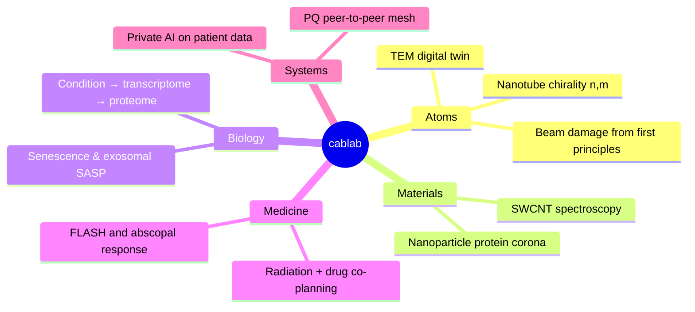

<div align="center">

<a href="https://www.ucf.edu"></a>
&nbsp;&nbsp;&nbsp;


*Physics-first models, honest uncertainty, software you can hold in one head.*

[Live TEM twin](https://cab-ucf.github.io/tem/) ·
[Join](#-join-the-lab) ·
[Principles](#-principles) ·
[Findings](#-findings)

</div>

---

> [!TIP]
> **Fly a 200 kV transmission electron microscope from your phone, right now:**
> [cab-ucf.github.io/tem](https://cab-ucf.github.io/tem/).
> Drag the knobs. Pinch to zoom. Nothing is uploaded; it all runs locally.

## 🔭 Science

We build *digital twins*: models of instruments, materials and patients
that are differentiable end to end and return a posterior, not a guess.



## ⚡ Findings

> [!NOTE]
> Preliminary, from simulation. Each number is regenerated by a script
> in its repository; none is typed by hand.

| | Result |
|---|---|
| 🔬 | Graphene knock-on cross sections of **6 / 67 / 359 mb** at 90 / 95 / 100 kV vs. measured 11 / 57 / 328 — **zero fitted parameters** |
| 🌀 | **27 / 27** nanotubes indexed to exact $(n,m)$ from nanobeam diffraction alone: $D$ within 1 %, chiral angle within 0.27° |
| 🎯 | A textbook stigmator spends **7–50×** the electron dose the Cramér–Rao bound allows. Alignment has a price; we can now quote it |
| ☢️ | FLASH at 100 Gy/s kills **4.8×** fewer circulating lymphocytes than 0.1 Gy/s for one 15 Gy fraction |
| 🛡️ | Planning beam *and* drug together keeps **23×** the tumour's CD8 T cells and **57×** the immune priming of a dose-only plan |
| 🐛 | A seeding hash made 1 in 5 tiles of a nanotube field a copy of another. Found by the twin's own tests, fixed, guarded by a million-tile check |

<details>
<summary><b>How the chirality trick works</b></summary>

Graphene's $\{10\}$ reflections give layer lines at $q=(n-m)k$,
$p=(2m+n)k$, $s=p+q$ with $k = 1/(\sqrt{3}\pi D)$, so

$$
\tan\theta = \frac{2p-s}{\sqrt{3}\,s},
\qquad I_\text{equator} \propto J_0^2(\pi D R)
$$

Angle from the layer lines, diameter from the equator's beading,
and the absolute height of $s$ splits armchair tubes where $p = s$.

</details>

## 🧪 Projects — *now recruiting*

<table>
<tr><td width="50%" valign="top">

### 🔬 temtwin
**A microscope that fits in a browser tab.**

Multislice physics in Rust, a wgpu console, deterministic replay,
and a stdin API so an *agent* can drive the column.
Beam damage, CBED, STEM, Thon rings: emergent, not scripted.

`Rust` `wgpu` `FFT` `NumPyro`

</td><td width="50%" valign="top">

### 🌈 cantsas
**Every spectrum, one posterior.**

Absorbance, Raman, PL, TGA and TEM of one carbon-nanotube
sample fused into chirality-resolved abundances with real
credible intervals. NNLS → MAP → NUTS.

`JAX` `NumPyro` `spectroscopy`

</td></tr>
<tr><td valign="top">

### ☢️ radix
**Cure in a day.**

One gradient from beam angles, dose rate and drug payload
through per-cell-type chromatin to the odds of an abscopal
response. Radiation that spares the immune system.

`differentiable physics` `ENCODE` `oncology`

</td><td valign="top">

### 🧬 kappa · c2p
**Predict the coat that decides a nanomedicine's fate.**

Patient condition → transcriptome → proteome → protein corona,
learned where data are abundant (≈190 k RNA-seq profiles) and
carried by adsorption physics where they are not.

`JAX` `generative models` `proteomics`

</td></tr>
<tr><td valign="top">

### 🧫 exoshift
**Silence the senescent secretome.**

Rank small molecules that rewrite the *cargo* of senescent-cell
vesicles instead of blocking them. Then test the winner in
human fibroblasts.

`aging` `drug repurposing` `EVs`

</td><td valign="top">

### 🛰️ irnet · [tydig](https://github.com/cab-ucf/tydig) · [irch](https://github.com/cab-ucf/irch) · [irpush](https://github.com/cab-ucf/irpush)
**The lab runs on its own network.**

One post-quantum iroh endpoint (X25519MLKEM768) under every app:
Typst co-editing saved in git, chat, push, a hospital-grade
private-AI mesh that brings code to the data.

`Rust` `iroh` `QUIC` `PQ crypto`

</td></tr>
</table>

## 📜 Principles

**Decentralized, peer-to-peer, post-quantum end-to-end encrypted.**
[iroh](https://iroh.computer) (Rust, QUIC, E2EE p2p) shows the way.
Keep it simple, think in Unix, and send or process only the information
a task needs.

| | Software | 🪞 | Science |
|---|---|---|---|
| 1 | **Plug-and-play, no required infrastructure.** Ultra-secure, highly private push with zero cloud setup. *Your desktops are the servers.* | ↔ | **Reproducible on any laptop.** One command (`just → podman → make → uv → typst`) rebuilds every figure and every number |
| 2 | **Modern, simple PQ crypto.** X-Wing (ML-KEM-768 + X25519). End-to-end only: nothing is decrypted off an endpoint. Minimal metadata. One key per purpose | ↔ | **Minimal sufficient information.** Code goes to the data, never the reverse. Patient records stay home. One model per question |
| 3 | **Rust as much as possible.** Platform glue stays a thin shell over the Rust core | ↔ | **Physics as the core.** Learning is a thin shell fitted only to what physics can't supply |
| 4 | **Efficiency.** Every packet and CPU cycle must compute something that matters. Battery first on mobile | ↔ | **Sample efficiency.** Every electron, label and assay must carry information. Priors where data are cheap, measurements where they are not, Cramér–Rao bounds to keep score |
| 5 | **Own infrastructure first.** No big-company infrastructure. No Google, no corporate clouds | ↔ | **Own the model.** Open, inspectable, differentiable twins of our own instruments, built on public data |
| 6 | **FOSS, minimal, Unix.** Small composable tools (one CLI, a Unix socket, files, systemd, Nix). Few well-trusted deps, no telemetry, no blobs, less code over more features | ↔ | **Small composable models.** Each physical term a module you can test alone. Fewer parameters over more. Every answer ships with its uncertainty |

> [!NOTE]
> **Sample efficiency is a core research focus**, as much as compute efficiency.
> Learning from 190 k cheap RNA-seq profiles to predict scarce corona data,
> or quoting the electron dose an alignment *must* cost: same idea,
> stated as a bound.

```diff
+ Every line of code is a liability. Perfection is nothing left to remove.
+ Explore before exploit: an hour of search saves a week of rewrite.
+ Be skeptical. If it exists, use it. If it isn't novel, say why.
+ Licensed AGPL / GPLv3.
- Telemetry. Proprietary blobs. Boilerplate. Required infrastructure.
```

## 🙋 Join the lab

> [!IMPORTANT]
> Undergrad, grad, or postdoc — if a card above made you want to open a
> terminal, write to **chase.brown@ucf.edu** with one line on which
> project and one link to something you built.

You'll get: real instruments *and* their twins, problems with
known answers to check yourself against, and code review
that deletes more than it adds.

<div align="center"><sub>
atoms → cells → patients, one gradient at a time
</sub></div>
