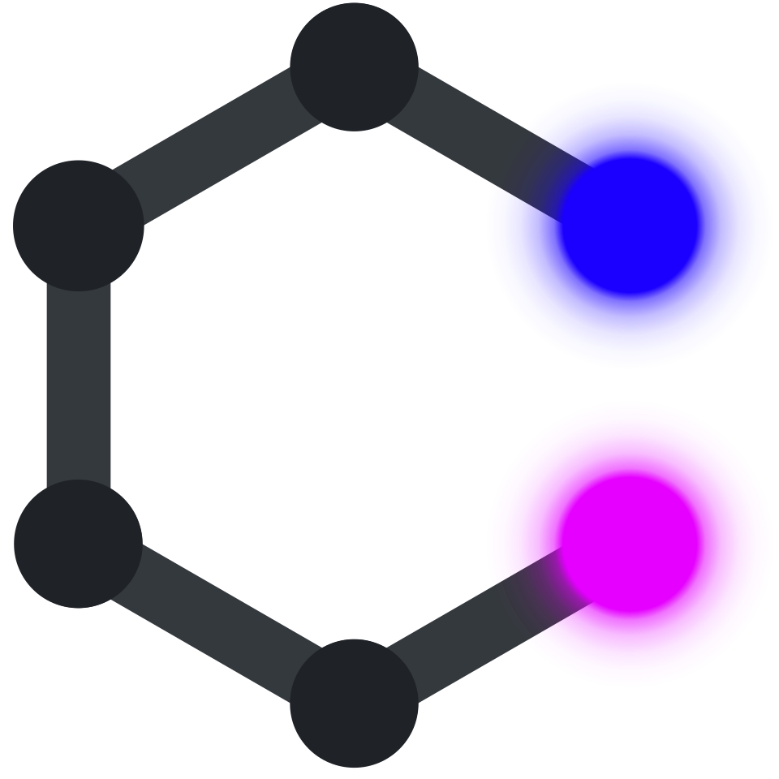
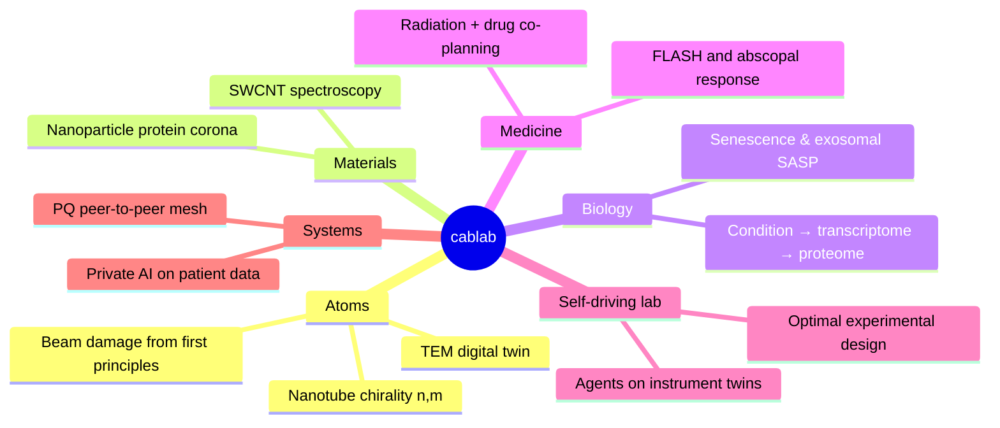
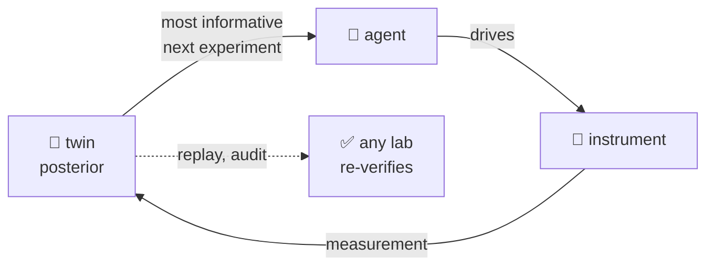

<div align="center">

<picture>
  <source media="(prefers-color-scheme: dark)" srcset="assets/lab_logo_min.svg">
  
</picture>

# cablab

*Self-driving science: physics-first twins, honest uncertainty,
software you can hold in one head.*

[Live TEM twin](https://cab-ucf.github.io/tem/) ·
[Self-driving lab](#-self-driving-lab) ·
[Join](#-join-the-lab) ·
[Principles](#-principles)

</div>

---

> [!TIP]
> **Fly a 200 kV transmission electron microscope from your phone, right now:**
> [cab-ucf.github.io/tem](https://cab-ucf.github.io/tem/).
> Drag the knobs. Pinch to zoom. Nothing is uploaded; it all runs locally.

## 🔭 Science

We build *digital twins*: models of instruments, materials and patients
that are differentiable end to end and return a posterior, not just a
point estimate. Then we hand them to agents.



## 🤖 Self-driving lab

An agent that has never touched a microscope should not learn on one.
We want them to learn on the twin, where every knob is a key, every run
replays bit for bit, and a mistake costs no sample, before they ever
drive the real thing.



- **Closed loop.** Posterior → choose the most informative experiment
  → run it → update. Stop when the question is answered, not when the
  budget is.
- **Sample efficient.** The Cramér–Rao bound says what a measurement
  *can* tell you; it is the yardstick for the agent.
- **Verifiable.** Deterministic replay and reproducible builds mean
  another self-driving lab can rerun our science and check it.

## 🧪 Projects — *now recruiting*

<table>
<tr><td width="50%" valign="top">

### 🔬 temtwin
**Train the agent that runs the microscope.**

Multislice physics in Rust, a wgpu console, deterministic replay,
and a stdin API so an *agent* can drive the column.
Beam damage, CBED, STEM and Thon rings from the physics.

`Rust` `wgpu` `FFT` `NumPyro`

</td><td width="50%" valign="top">

### 🌈 cantsas
**Every spectrum, one posterior.**

Absorbance, Raman, PL, TGA and TEM of one carbon-nanotube
sample fused into chirality-resolved abundances with real
credible intervals. NNLS → MAP → NUTS.

`JAX` `NumPyro` `spectroscopy`

</td></tr>
<tr><td valign="top">

### ☢️ radix
**Toward cure in a day.**

One gradient from beam angles, dose rate and drug payload
through per-cell-type chromatin to the odds of an abscopal
response. Radiation planned to spare the immune system.

`differentiable physics` `ENCODE` `oncology`

</td><td valign="top">

### 🧬 kappa · c2p
**Predict the coat that decides a nanomedicine's fate.**

Patient condition → transcriptome → proteome → protein corona,
learning from abundant RNA-seq data and leaning on adsorption
physics where corona data are scarce.

`JAX` `generative models` `proteomics`

</td></tr>
<tr><td valign="top">

### 🧫 exoshift
**Silence the senescent secretome.**

Rank small molecules that rewrite the *cargo* of senescent-cell
vesicles instead of blocking them. Then test the winner in
human fibroblasts.

`aging` `drug repurposing` `EVs`

</td><td valign="top">

### 🛰️ irnet · [tydig](https://github.com/cab-ucf/tydig) · [irch](https://github.com/cab-ucf/irch) · [irpush](https://github.com/cab-ucf/irpush)
**The lab runs on its own network.**

One post-quantum iroh endpoint (X25519MLKEM768) under every app:
Typst co-editing saved in git, chat, push, and a private-AI
mesh that brings code to the data.

`Rust` `iroh` `QUIC` `PQ crypto`

</td></tr>
</table>

## 📜 Principles

**Decentralized, peer-to-peer, post-quantum end-to-end encrypted.**
[iroh](https://iroh.computer) (Rust, QUIC, E2EE p2p) shows the way.
Keep it simple, think in Unix, and send or process only the information
a task needs.

| 🖥️ Software | 🔬 Science |
|---|---|
| **Zero-trust FOSS.** Independent of companies, built by fully reproducible systems | **Reproducible science**, verifiable by any self-driving lab |
| **Peer-to-peer, no required infrastructure.** Your machines are the servers | **Decentralized science.** Instruments, twins and agents as peers |
| **Post-quantum E2EE.** Lattice-based X-Wing (ML-KEM-768 + X25519), minimal metadata, one key per purpose | **Lattices and quasicrystals.** The high-dimensional lattices behind PQ crypto, projected down, give quasicrystals |
| **Rust-based code core:** low-level, efficient and secure | **Ab-initio physics core:** low-level, from first principles |
| **CPU and networking efficiency.** Battery first | **Sample efficiency in AI & ML** |
| **Small composable Unix tools.** Less code over more features | **Small composable models.** Fewer parameters, every answer with its uncertainty |

> [!NOTE]
> **Sample efficiency is a core research focus**, as much as compute efficiency.
> It is what lets a self-driving lab stop early.

```diff
+ Every line of code is a liability. Perfection is nothing left to remove.
+ Explore before exploit: an hour of search saves a week of rewrite.
+ Be skeptical. If it exists, use it. If it isn't novel, say why.
+ Licensed AGPL / GPLv3.
- Telemetry. Proprietary blobs. Boilerplate. Required infrastructure.
```

## 🙋 Join the lab

> [!IMPORTANT]
> Undergrad, grad, or postdoc — if a card above made you want to open a
> terminal, write to **chase.brown@ucf.edu** with one line on which
> project and one link to something you built.

You'll get: real instruments, their twins, and the agents that run both, problems with
known answers to check yourself against, and code review
that deletes more than it adds.

<div align="center"><sub>
atoms → cells → patients, one gradient at a time
</sub></div>
